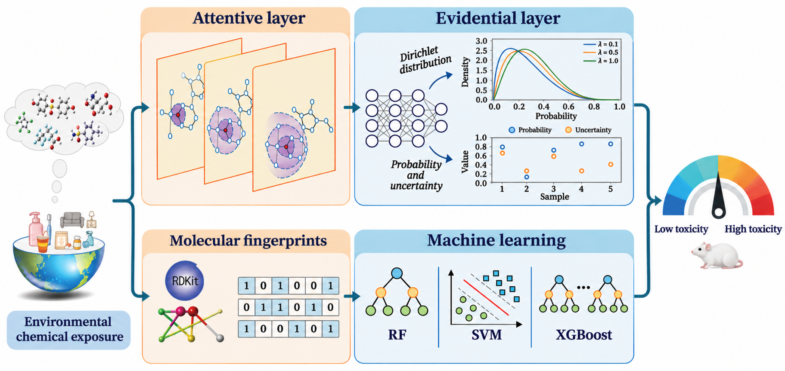

# Uncertainty-aware graph attention network for subchronic toxicity prediction and chemical prioritization
## Overview
In this study, we developed a graph attention network with the evidential layer (EviGAT) to classify rat oral subchronic toxicity from molecular structures. EviGAT outperformed traditional ML. The AUCROC on the test and external validation sets were 0.764 and 0.756, respectively. Compared with GAT, EviGAT effectively alleviated the problem of giving overconfident but incorrect predictions. Atom-level attention highlighted key substructures associated with subchronic toxicity. We further applied EviGAT to predict subchronic toxicity of 17,219 compounds from the EPA Chemicals and Products Database. 512 of them were identified as high toxicity with low uncertainty in the application domain. These results underscore the potential of EviGAT as a robust tool for subchronic toxicity and the promising application for prioritizing compounds with high-confidence predictions for experimental validation.
<p align="center">

</p>

## Table of Contents
- [Environment Setup](#Environment-Setup) 
- [Data Loading](#Data-Loading)
- [Training](#Training)


## Environment Setup
### Clone the repository:
```bash
git clone https://github.com/lZhao-Git/EviGAT.git
cd EviGAT
```

### Using conda or pip
```bash
conda env create -f EviGAT.yml
conda activate EviGAT
pip install -r requirements.txt
```

## Data Load
- **Data**: The datasets used for model training and evaluation are located in the data folder

## Training
- **Training**: The training script is executed from the command line using ```python train.py```


